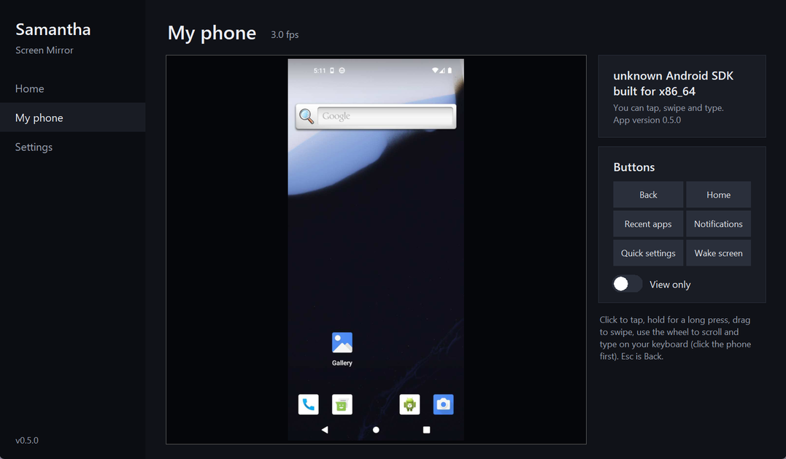

# Samantha Screen Mirror

**Your Windows PC on your phone, and your Android phone on your PC.** From anywhere, privately. No accounts, no
cloud, no port forwarding: everything goes straight between your own devices through your own
[Tailscale](https://tailscale.com) network.

There are two apps, and they talk to each other:

- **Samantha for Windows**, a window on your PC. It runs quietly in the background and starts with Windows.
- **Samantha for Android**, an app on your phone.

| On the phone | On the PC |
|---|---|
| **Show my PC**: watch your PC screen live, full screen, pinch to zoom, up to 60 fps | **My phone**: see your phone live and use it with the mouse and keyboard |
| Hear the PC's sound (if you switch it on) | Click to tap, drag to swipe, scroll with the wheel, type on the keyboard |
| Screenshots of the PC, quality presets, screen picker | Back, Home, Recent apps, Notifications buttons, a View-only switch |

<p align="center">
  
  
</p>

## What is it for?

- Check on a **long download, render, export, backup or install** without walking back to the desk
- Keep an eye on a **home or work PC** that is running something while you are out
- **Read something** on the big screen from the couch (pinch to zoom), or listen to what the PC is playing
- **Answer a message or use an app on your phone from the PC**, with a real keyboard, while the phone stays in your bag

What it is **not**: the phone can only *look at* the PC (no clicking or typing on the PC, on purpose, which makes it
much safer); it is not for sharing your screen with other people; and it is not a cloud service. Nobody else,
including this project, can see anything.

## Get started

You need: a Windows 10/11 PC, an Android phone (Android 11 or newer), and a free Tailscale account.
(iPhone? See [iPhone](#iphone).)

**On the PC**

1. Download `SamanthaScreenMirror-windows.zip` from the [Releases](../../releases/latest) page and unzip it somewhere
   permanent (for example `C:\Apps`).
2. Double-click **`Samantha.exe`**. (Windows may warn about an unrecognised app because the program is not
   code-signed: choose *More info > Run anyway*.)
3. The window checks **Tailscale** (it offers to install it; open it and sign in) and then **Start Samantha**.
   From now on Samantha starts by itself when you log in to Windows, and the Samantha shortcut opens the window.

**On the phone**

1. Install the free **Tailscale** app from the Play Store, sign in with the **same account** as the PC and switch it on.
2. On the PC, Samantha's **Home** page shows a QR code: scan it with the phone's camera. It downloads
   **Samantha Setup** (`SamanthaSetup.apk`). Open the downloaded file to install it (Android asks once to allow
   installs from your browser), open Samantha Setup and tap **Install Samantha** (Android asks once to allow Setup to
   install apps). Afterwards you can remove Setup.
3. Open Samantha on the phone. On the PC click **Show a code**. Type the **PC address** and the **code** from the PC
   into the phone and tap **Connect**. That's it: the phone remembers the PC.

> **Why a setup app?** Android 13 and newer block the Accessibility switch ("Restricted setting") for an app installed
> straight from a downloaded file, and many phones hide the option that unblocks it. An app installed by Samantha
> Setup is not blocked.

**To see the PC on the phone:** tap **Show my PC**.

**To see and use the phone on the PC** (once): in the phone app, under *Let this PC see and use my phone*, tap
**Turn it on**, choose Samantha in the list and switch it on. Then open **My phone** in the window on the PC.

> **"Restricted setting"?** Samantha was installed straight from the downloaded file instead of with Samantha
> Setup. In the Samantha app tap **Get Samantha Setup**, install and open it, tap **Remove the old Samantha** and then
> **Install Samantha**, and pair with your PC again. (On some phones *App info > three dots > Allow restricted
> settings* also works, but many phones do not show it.)

## Using it

**The phone app.** *Show my PC* opens the PC full screen. Tap to show or hide the bars, pinch to zoom, drag to look
around, double-tap to zoom in or back out. **Rotate** switches between sideways (the default, a PC screen is wide) and
upright. **More** has the quality presets, the screen picker (for several monitors), the mouse pointer switch and
**Save a screenshot of the PC** (full resolution, into *Pictures/Samantha*). The phone stays awake while you watch.

| Preset | Size | fps | Roughly (constant motion) |
|---|---|---|---|
| Data saver | 960x540 | 15 | 0.5 MB/s |
| Balanced (default) | 1440x810 | 30 | 3 MB/s |
| Sharp | 1920x1080 | 30 | 5 MB/s |
| Smooth | 1440x810 | 60 | 6 MB/s |

A still screen costs almost nothing, because pictures are only sent when something changes. *Smooth* sends twice the
data, so use it on Wi-Fi. Presets apply to everyone watching that PC.

**Sound.** Switch on **Play the PC's sound** in the phone app (or **Sound** in the viewer). It is off until you do,
and it is per phone. The phone plays whatever the PC plays (the PC's speakers keep playing too). It needs about
1.5 Mbit/s (*Use less data* makes it mono: a quarter of that) and runs a fraction of a second behind the picture.
The PC records nothing while no phone listens. To forbid sound completely, switch it off under **Settings** in the
window on the PC.

**The window on the PC.**
- **Home**: whether Samantha is on (**Turn off** keeps it off, also after a restart, until **Turn on**), the PC's
  address and a pairing code, and **Update now** when there is a new version.
- **My phone**: your phone, live (about 3 pictures a second: Android allows no more for this). Click to tap, hold
  for a long press, drag to swipe, scroll with the wheel. Click the phone, then type on your keyboard; Esc is Back.
  **View only** stops the mouse and keyboard from doing anything. The phone only sends its screen while this page is
  open, and shows a notification while it does.
- **Settings**: sound, **Sign out all phones** (they need a new code), the browser link for an iPhone, and updates.

Closing the window does not stop Samantha; it keeps running in the background so your phone can always reach the PC.

**On the phone, you stay in control.** *Allow tapping, swiping and typing* (on by default) and **Pause** are in the
app, and turning off the Accessibility switch in Android stops it completely.

## Updates

Both apps update themselves:

- **PC**: when a new version is out, the window shows **Update available**. Click **Update now**: it downloads the new
  version from this project's Releases page, checks its SHA-256 checksum, swaps it in (your settings are kept; a failed
  swap puts the old version back), restarts Samantha and reopens the window. It checks GitHub every 12 hours.
- **Phone**: after the PC has updated, the phone app shows **Update available**. Tap **Update**: it downloads the
  matching app from your own PC and Android asks you to confirm. (The first time, Android asks to allow Samantha to
  install updates.)

**Coming from 0.4.x?** Run the update once as before (`samantha-mirror update`, or double-click `samantha-mirror.exe`
and say yes). Your shortcuts and taskbar pin then open the new window. If you had installed the earlier companion app
*Samantha Phone*, it updates to the new Samantha app from the PC; if Android says the update conflicts with the
installed app, uninstall the old one and install the new one from the QR code on the PC.

## iPhone

There is no iPhone app (Apple does not allow one to be installed from outside the App Store), and an iPhone cannot be
shown on the PC. An iPhone can still **watch the PC** in Safari: in the window on the PC go to **Settings > iPhone or a
web browser > Show the link**, and scan it with the iPhone's camera (Tailscale must be on in the iPhone). Then
*Share > Add to Home Screen*. The same works in any browser in your tailnet.

## How it works

```
Android: Samantha app ----Tailscale (WireGuard)----> PC: Samantha (background service + window)
  Show my PC   <---- picture (JPEG stream), sound (PCM) ----   screen capture (DXGI), speaker loopback
  phone screen ----- screenshots (Accessibility) --------->   "My phone" in the window
  taps, typing <---- commands -----------------------------   mouse and keyboard in the window
```

- The PC listens **only** on its Tailscale address (`100.x.y.z`) and refuses to start otherwise. Every request needs
  the secret token, which the phone gets once by sending the pairing code.
- The phone app always connects **out** to the PC. It never accepts connections, so nothing can reach into the phone.
- Capture runs only while someone is watching, in both directions.

See [SECURITY.md](SECURITY.md) for the full threat model.

## Troubleshooting

The window's Home page says what is wrong. For a full check, run `samantha-mirror doctor` (see *Command line* below).

- **The phone says "Can't reach your PC"**: Tailscale is off on the phone, or the PC is asleep or not signed in to
  Windows. Set Windows to never sleep while plugged in (Settings > System > Power).
- **"This PC no longer accepts this phone"**: someone used *Sign out all phones* (or the token changed). In the phone
  app tap *Forget this PC* and pair again with a new code.
- **"That code is wrong or has run out"**: click **New code** on the PC and type it within 10 minutes.
- **"PC screen can't be captured right now"**: the PC is locked or showing a secure prompt (UAC). It recovers when you
  unlock it.
- **"My phone" says no phone is connected**: in the phone app, *Let this PC see and use my phone* should say
  *Connected*. If it says *Off*, switch on Accessibility (see *Get started*). If *Pause* is on, switch it off.
- **No sound on the phone**: switch it on in the phone app, check the phone's volume, and check that sound is allowed
  in the window's Settings.
- **I want it off for now**: **Turn off** on the window's Home page. It stays off until you **Turn on** again.
- **Choppy on mobile data**: choose the *Data saver* preset (viewer > More).
- **Nothing connects at all**: a Windows Firewall rule may be needed. In an Administrator PowerShell:
  ```powershell
  New-NetFirewallRule -DisplayName "Samantha Screen Mirror (Tailscale only)" -Direction Inbound `
    -Protocol TCP -LocalPort 8787 -RemoteAddress 100.64.0.0/10 -Action Allow
  ```

## Command line

Everything is in the window, but the command line is there for scripts and troubleshooting. In PowerShell, in the
program's folder: `.\samantha-mirror.exe <command>` (from source: `.\.venv\Scripts\samantha-mirror <command>`).

| Command | What it does |
|---|---|
| `app` | Open the Samantha window |
| `doctor` | Check everything and say how to fix problems |
| `setup` | Guided first-time setup in the console |
| `link` | Show the browser link and QR code (for an iPhone) |
| `run` | Run the server in this console (Ctrl+C stops it) |
| `stop` / `start` | Turn Samantha off (stays off after a restart) / on again |
| `autostart install/remove/status` | Start hidden at every Windows logon |
| `update` | Check for and install a new version (`--check` only looks, `-y` skips the question) |
| `uninstall` | Remove autostart and the HTTPS setup (keeps your settings) |

## Settings file

`%APPDATA%\SamanthaScreenMirror\.env` (or the project folder when you run from a checkout; set `SM_HOME` to use
another folder). The window manages it; you rarely need to touch it.

| Variable | Default | Meaning |
|---|---|---|
| `SM_TOKEN` | generated | Access secret, min 16 chars. **Keep private.** *Sign out all phones* replaces it. |
| `SM_PORT` | 8787 | Port on the Tailscale address (the phone app assumes 8787 unless you type another) |
| `SM_MONITOR` | 1 | Monitor to start with (0 = all combined) |
| `SM_FPS` | 30 | Max frames per second (1-60) |
| `SM_JPEG_QUALITY` | 70 | 10-95 |
| `SM_SCALE` | 0.75 | 0.1-1.0 size of the stream |
| `SM_MAX_CLIENTS` | 3 | Max simultaneous viewers |
| `SM_CURSOR` | 1 | Draw the mouse pointer on the stream |
| `SM_CAPTURE` | auto | `auto` (DXGI, falls back to mss), `dxgi`, or `mss` |
| `SM_UPDATE_CHECK` | 1 | Look for new releases on GitHub every 12 hours (only contacts api.github.com) |
| `SM_AUDIO` | 1 | Let phones hear this PC's sound (each phone must also switch it on). `0` forbids it |
| `SM_LOOPBACK` | 0 | Also listen on 127.0.0.1 (set by `setup` when you enable HTTPS for the iPhone page) |

## Limitations

- Windows only on the PC side (capture and autostart are Windows-specific). Android only on the phone side.
- The PC is view-only from the phone **by design** (no remote control of the PC, now or later).
- The phone on the PC is a few pictures a second (Android's limit for this permission): fine for using apps and
  reading, not for watching videos. Banking apps and password prompts show black (Android blocks them). A swipe is
  sent when you let go of the mouse. Typing works in normal text fields. The phone's sound does not come to the PC.
- Sound is raw uncompressed audio (no codec), so it needs Wi-Fi-like bandwidth.
- The PC picture is a JPEG stream, not video: documents and desktops are very light, full-screen video over a slow
  connection looks choppy. H.264 was left out on purpose: the good software encoder (x264) is GPL, which would change
  this project's MIT license for the download.

## Development

See [CONTRIBUTING.md](CONTRIBUTING.md). Quick version: `pip install -e ".[dev]"`, then `ruff check .` and `pytest`.
CI builds the Windows download and the Android app when a version tag (e.g. `v0.5.0`) is pushed.

```
samantha_mirror/
  desktop.py    the Samantha window (Tkinter)     server.py   Flask routes (the API both apps use)
  capture.py    screen -> JPEG                    audio.py    speaker loopback -> PCM
  phonelink.py  phone <-> PC relay                pairing.py  6-digit pairing codes
  runner.py     background service                updater.py  check/install releases
  cli.py        command line                      doctor.py, wizard.py, tailscale.py, autostart.py, ...
  web/          built browser page for iPhones (source in web/)
android/        the Android app (plain Java, built by android/build.py without Gradle)
packaging/      PyInstaller spec for the Windows download
tests/          pytest (tests/test_android.py also runs the app's networking code on the PC)
```

## License

[MIT](LICENSE)
