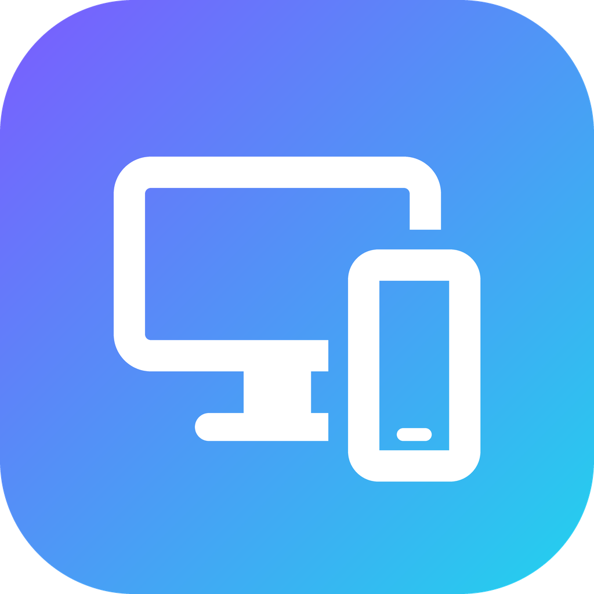
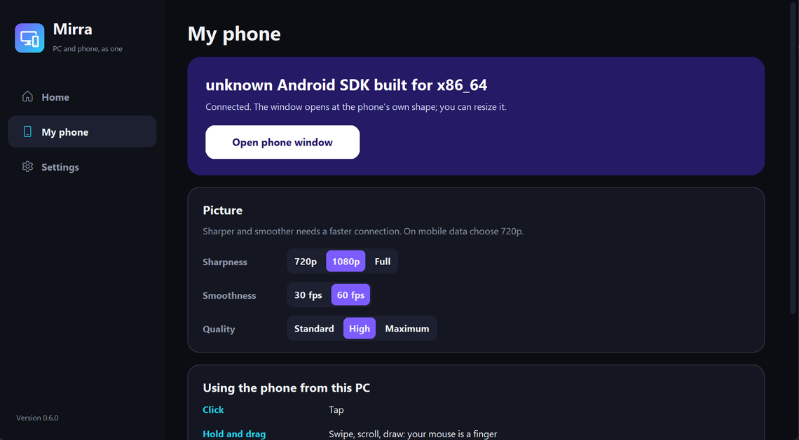
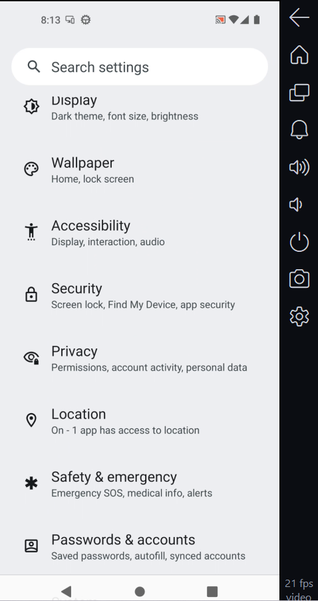
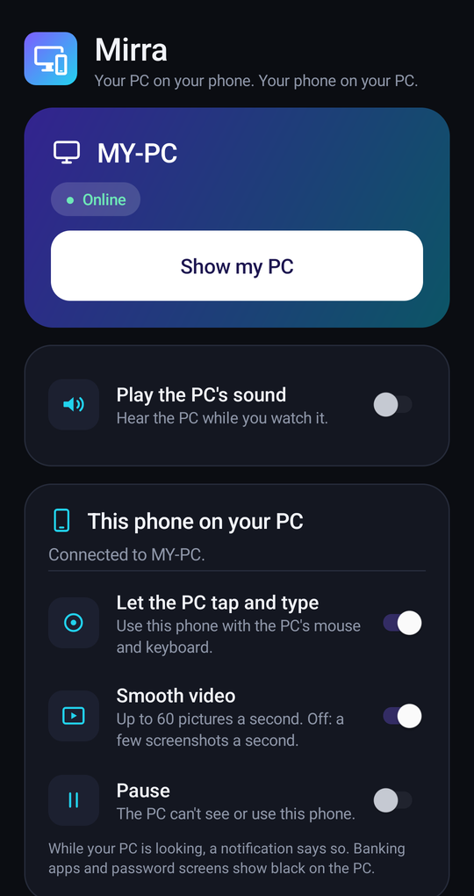

<p align="center"></p>

<h1 align="center">Mirra</h1>

<p align="center"><b>Your PC on your phone. Your phone on your PC.</b><br>
Private, from anywhere, no cloud. Free and open source.</p>

<p align="center">
  
  
  
</p>

Mirra is two apps that work together: **Mirra for Windows** on your PC and **Mirra for Android** on your phone.

- **See your PC on your phone**, live and full screen, with its sound if you want it. Pinch to zoom, take screenshots.
- **See and use your phone on your PC**, in its own phone-shaped window, smooth (up to 60 pictures a second) and
  sharp. Your mouse is your finger, your keyboard types on the phone.
- **Send files both ways**: drop files on the phone window (they land in the phone's Downloads), or tap **Share >
  Mirra** in any app on the phone (they land in `Downloads\Mirra` on the PC).
- **Private**: everything goes straight between your own devices through [Tailscale](https://tailscale.com), a free
  private network. Nobody else, including this project, can see anything.

(Mirra was called *Samantha Screen Mirror* before version 0.6.)

## Which file do I download?

Go to the [latest release](../../releases/latest) and download only what you need:

| You have | Download | What it is |
|---|---|---|
| A Windows PC | **`Mirra-for-Windows-Setup.exe`** | The installer. Double-click it, click *Next*, done. |
| An Android phone | **`Mirra-for-Android-Setup.apk`** | Easiest: don't download it yourself. Scan the QR code in Mirra on your PC and it comes from your PC. |
| A Windows PC, no installer wanted | `Mirra-for-Windows.zip` | The same program as a folder. Unzip it somewhere permanent and open `Mirra.exe`. |
| *(nothing to do)* | `Mirra-for-Windows.zip.sha256` | Used by Mirra to check its own updates. You don't need it. |

An iPhone? There is no iPhone app, but an iPhone can watch the PC in Safari (see [iPhone](#iphone)).

Windows may say *"Windows protected your PC"* the first time, because the program is not code-signed (that costs
money): click *More info*, then *Run anyway*.

## Set it up (5 minutes, once)

**1. On the PC**
1. Run **`Mirra-for-Windows-Setup.exe`**. Mirra opens when it is done.
2. Mirra checks **Tailscale** (it offers to install it: open it and sign in, it's free), then click **Start Mirra**.
   From now on Mirra starts by itself with Windows.

**2. On the phone**
1. Install **Tailscale** from the Play Store, sign in with the **same account** as the PC, and switch it on.
2. Point the phone's **camera** at the QR code on Mirra's **Home** page on the PC and tap the link.
3. Tap **Open Mirra and connect**. The first time, this downloads **Mirra Setup** from your PC: open the download,
   install it, open **Mirra Setup** and tap **Install Mirra**. Then go back to the page and tap the button again.
   Mirra opens and connects by itself.

No camera? Open Mirra on the phone and type the PC's name and the code shown on the PC.

**3. To see the phone on the PC** (once): in Mirra on the phone, under *This phone on your PC*, tap **Turn it on**,
choose **Mirra** in Android's list and switch it on. Then click **Open phone window** in Mirra on the PC.

> **Why "Mirra Setup"?** Android 13 and newer block that switch ("Restricted setting") for apps installed straight
> from a downloaded file, and many phones hide the option that unblocks it. Mirra Setup installs Mirra the way app
> stores do, so the switch simply works.

## Using it

**On the phone** tap **Show my PC**: full screen, sideways (tap **Rotate** for upright), pinch to zoom, double-tap
to zoom in or out, tap once for the bars. **More** has quality presets, the screen picker and **Save a screenshot**.
Switch on **Play the PC's sound** to hear the PC.

**On the PC**, the **phone window** shows your phone at its own shape, at up to 60 pictures a second:

| Do this | To |
|---|---|
| Click | Tap |
| Hold and drag | Swipe, scroll, draw: the mouse is a finger |
| Mouse wheel | Scroll |
| Right click, or Esc | Back |
| Middle click | Home |
| Type | Type on the phone (tap a text field first) |
| Ctrl + V | Paste the PC's clipboard on the phone |

The toolbar beside it has Back, Home, Recent apps, Notifications, volume, lock, **save a screenshot on the PC**
(into *Pictures\Mirra*) and picture quality (720p / 1080p / Full, 30 / 60 fps, Standard / High / Maximum).

**Files, both ways:**

| From | Do this | It lands in |
|---|---|---|
| PC to phone | Drop files on the phone window, or click its **Send a file** button (or *My phone > Send files to the phone*) | *Downloads* on the phone (a notification opens it) |
| Phone to PC | In any app tap **Share**, then **Mirra**. Or in Mirra on the phone tap **Send files to the PC** | `Downloads\Mirra` on the PC (Mirra shows a notice with *Open folder*) |

Up to 1 GB per file. Sending to the phone needs *This phone on your PC* switched on in the phone app.

The first time each session the phone asks Android to record its screen, and Mirra answers *Start now* for you, so
nobody has to tap it. While the PC looks, the phone shows a notification. If recording is not possible, Mirra falls
back to a few screenshots a second.

**The Mirra window on the PC**: **Home** shows whether Mirra is on (the switch turns it off and keeps it off), the
QR code to connect a phone and your phone's status. **My phone** opens the phone window and sets its quality.
**Settings**: sound, updates, *Sign out all phones*, the iPhone link, the log folder.

Closing the window does not stop Mirra; it keeps running in the background so your phone can always reach the PC.

**On the phone, you stay in control**: *Let the PC tap and type*, *Smooth video* and **Pause** are switches in the
app, and turning off the Accessibility switch in Android stops it completely. Banking apps and password screens show
black on the PC (Android blocks them).

## Updates

Both apps update themselves:

- **PC**: when a new version is out, Mirra shows a pop-up: **Update now** or **Later**. It downloads the new version
  from this project's releases page, checks its SHA-256 checksum, swaps it in (your settings are kept; a failed swap
  puts the old version back), and opens again. It checks every few hours (Settings > Updates).
- **Phone**: when a new version is out, Mirra on the phone shows a pop-up too (**Update now** or **Later**) and
  downloads it from this project's releases page, the same place as the PC. Android asks you to confirm. If GitHub
  can't be reached, it takes the matching version from your own PC instead.

**Coming from Samantha Screen Mirror 0.5 or older?** Click *Update now* there (or run `samantha-mirror update`). It
becomes Mirra, and your shortcuts become *Mirra* shortcuts. On the phone, install Mirra with **Mirra Setup** (it
replaces the old app; connect again afterwards).

## iPhone

There is no iPhone app (Apple does not allow installing one from outside the App Store), and an iPhone cannot be
shown on the PC. An iPhone can still **watch the PC** in Safari: in Mirra on the PC go to **Settings > iPhone or a
web browser > Show the link**, and scan it with the iPhone's camera (Tailscale must be on in the iPhone). Then
*Share > Add to Home Screen*.

## How it works

```
Android: Mirra ----Tailscale (WireGuard, encrypted)----> PC: Mirra (background service + window)
  Show my PC   <---- picture (JPEG stream), sound (PCM) ----   screen capture (DXGI), speaker loopback
  this screen  ----- H.264 video (or screenshots) -------->   the phone window (decoded with OpenCV)
  touches      <---- touch, key and text events ----------   mouse and keyboard in the phone window
```

- The PC listens **only** on its Tailscale address (`100.x.y.z`) and refuses to start otherwise. Every request needs
  the secret token, which a phone gets once by sending the pairing code shown on the PC.
- The phone app always connects **out** to the PC. It never accepts connections, so nothing can reach into the phone.
- Capture runs only while someone is watching, in both directions.

See [SECURITY.md](SECURITY.md) for the full threat model.

## Troubleshooting

- **The phone says "Can't reach your PC"**: Tailscale is off on the phone, or the PC is asleep or not signed in to
  Windows. Set Windows to never sleep while plugged in (Settings > System > Power).
- **The QR code's page does not open**: Tailscale must be on in the phone (the page comes from your PC).
- **"This PC no longer accepts this phone"**: someone used *Sign out all phones*. In the phone app tap *Forget this
  PC*, then scan the QR code again.
- **"Restricted setting" on the phone**: Mirra was installed from the downloaded file directly. In the app tap **Get
  Mirra Setup** and let it install Mirra again.
- **The phone window says "Waiting for your phone"**: in Mirra on the phone, *This phone on your PC* must be on and
  not paused. The first picture can take a second or two.
- **"PC screen can't be captured right now"**: the PC is locked or showing a secure prompt. It recovers when unlocked.
- **No sound on the phone**: switch it on in the phone app and check that sound is allowed in Settings on the PC.
- **Nothing connects at all**: a Windows Firewall rule may be needed. In an Administrator PowerShell:
  ```powershell
  New-NetFirewallRule -DisplayName "Mirra (Tailscale only)" -Direction Inbound -Protocol TCP `
    -LocalPort 8787,8788 -RemoteAddress 100.64.0.0/10 -Action Allow
  ```

For a full check, run `samantha-mirror doctor` in PowerShell in Mirra's folder.

## Command line

Everything is in the window, but the command line (`samantha-mirror.exe` in Mirra's folder) is there for scripts:
`doctor` (check everything), `update` (`--check`, `-y`), `stop` / `start`, `link` (iPhone link and QR code),
`setup` (console setup), `uninstall` (remove start-at-logon), `app` (open the window), `run` (run the server here).

## Settings file

`%APPDATA%\SamanthaScreenMirror\.env` (the folder kept its old name so updates keep your settings). The window manages
it; you rarely need to touch it.

| Variable | Default | Meaning |
|---|---|---|
| `SM_TOKEN` | generated | Access secret. **Keep private.** *Sign out all phones* replaces it. |
| `SM_PORT` | 8787 | Port on the Tailscale address (the live phone link uses the next port, 8788) |
| `SM_MONITOR` / `SM_FPS` / `SM_JPEG_QUALITY` / `SM_SCALE` | 1 / 30 / 70 / 0.75 | The PC picture's defaults |
| `SM_MAX_CLIENTS` | 3 | Max simultaneous viewers |
| `SM_CURSOR` | 1 | Draw the mouse pointer on the PC picture |
| `SM_CAPTURE` | auto | `auto` (DXGI, falls back to mss), `dxgi`, or `mss` |
| `SM_UPDATE_CHECK` | 1 | Look for new versions on GitHub (only contacts api.github.com) |
| `SM_AUDIO` | 1 | Let phones hear this PC's sound (each phone must also switch it on) |
| `SM_LOOPBACK` | 0 | Also listen on 127.0.0.1 |

## Limitations

- Windows on the PC, Android 11 or newer on the phone (iPhones: watching the PC in Safari only).
- The PC is view-only from the phone **by design**: no remote control of the PC, now or later.
- Banking apps and password screens show black on the PC (Android blocks them). Typing works in normal text fields.
  The phone's sound does not come to the PC.
- The PC picture on the phone is a JPEG stream: documents and desktops are very light, full-screen video over a slow
  connection looks choppy. Sound is uncompressed, so it needs Wi-Fi-like speed.

## Development

See [CONTRIBUTING.md](CONTRIBUTING.md). Quick version: `pip install -e ".[dev]"`, then `ruff check .` and `pytest`.

```
samantha_mirror/   the PC side (Python; the package kept its old name)
  desktop.py       the Mirra window (CustomTkinter)     phonewindow.py  the phone window (H.264 via OpenCV)
  server.py        the web API both apps use            streamrelay.py  the live phone link (port + 1)
  capture.py       PC screen -> JPEG                    audio.py        speaker loopback -> PCM
  phonelink.py     phone commands relay                 pairing.py, joinpage.py  pairing by QR code
  transfer.py      files both ways                      dropfiles.py    files dropped on a window
  runner.py        background service                   updater.py      updates
android/           Mirra for Android (plain Java, built by android/build.py without Gradle)
android/setup/     Mirra Setup (installs the app so Android does not restrict it)
packaging/         PyInstaller spec, the installer (mirra.iss), the logo, build-release.ps1
web/               the browser page for iPhones (React)
tests/             pytest (tests/test_android.py also runs the app's networking code on the PC)
```

## License

[MIT](LICENSE)
